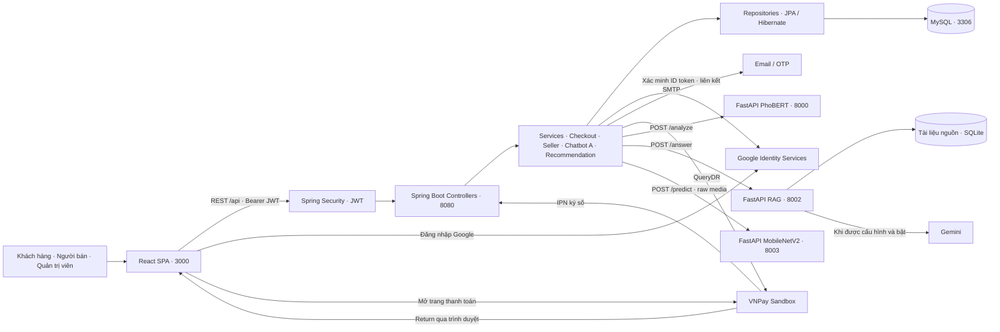

#  TeaSmart Backend


Backend TeaSmart cung cấp REST API cho website thương mại điện tử chè Thái Nguyên. Spring Boot xử lý xác thực, phân quyền, catalog, khách hàng, người bán, đặt hàng và thanh toán. Các dịch vụ Python xử lý phân tích cảm xúc, truy xuất kiến thức và suy luận ảnh/video lá chè.

[Repository TeaSmart-FE](https://github.com/BigBoss1208/TeaSmart-FE)

[Kho nghiên cứu MobileNetV2 · mã huấn luyện, hồ sơ làm sạch và kết quả Test](https://github.com/BigBoss1208/TeaSmart-AI-Leaf)

## Mục lục

- [Chức năng và kiến trúc](#chức-năng-và-kiến-trúc)
- [Công nghệ và yêu cầu môi trường](#công-nghệ-và-yêu-cầu-môi-trường)
- [Cài đặt MySQL](#cài-đặt-mysql)
- [Cấu hình hệ thống](#cấu-hình-hệ-thống)
- [Chuẩn bị và chạy dịch vụ AI](#chuẩn-bị-và-chạy-dịch-vụ-ai)
- [Khởi động và sử dụng](#khởi-động-và-sử-dụng)
- [Các API chính](#các-api-chính)
- [Kết quả MobileNetV2](#kết-quả-mobilenetv2)
- [Cấu trúc thư mục](#cấu-trúc-thư-mục)
- [Kiểm thử](#kiểm-thử)
- [Xử lý lỗi](#xử-lý-lỗi)
- [Thông tin đồ án](#thông-tin-đồ-án)

## Chức năng và kiến trúc

- **Xác thực và tài khoản** · Đăng ký, đăng nhập, kiểm tra ID token Google, liên kết tài khoản Google, khôi phục mật khẩu bằng OTP qua email và quản lý hồ sơ. Spring Security xác thực Bearer JWT và phân quyền `CUSTOMER`, `SELLER`, `ADMIN`.
- **Thương mại điện tử** · Catalog sản phẩm, danh mục, vùng chè và cửa hàng, địa chỉ, giỏ hàng, yêu thích, đặt hàng, đánh giá và theo dõi đơn. Kiểm tra quyền sở hữu trên dữ liệu cá nhân, đơn và tài nguyên gian hàng.
- **Checkout và thanh toán** · Checkout session giữ dữ liệu mua và reservation. COD xác nhận qua session. Với VNPay Sandbox, một payment attempt được tạo trước khi trình duyệt chuyển sang cổng thanh toán. Server xác minh chữ ký, merchant, mã tham chiếu và số tiền trước khi xử lý Return/IPN. Đơn VNPay chỉ được tạo sau khi xác minh thanh toán thành công. Callback lặp được xử lý theo trạng thái giao dịch. Browser Back thiếu kết quả xác thực giữ cơ chế chống thanh toán trùng và đối soát.
- **Người bán và quản trị** · Người bán quản lý hồ sơ, sản phẩm, tồn kho, đơn và thống kê của gian hàng. Quản trị viên quản lý catalog, khách hàng, đơn, đánh giá, duyệt hồ sơ người bán và xem doanh thu theo trạng thái thanh toán.
- **Chatbot A** · Phân loại ý định và ngữ cảnh hội thoại bằng quy tắc. Dùng nhu cầu, ngân sách, vùng chè, khẩu vị và ID sản phẩm đang xem để trả lời hoặc trả thẻ sản phẩm từ catalog. Xếp hạng bán chạy dựa trên đơn `DELIVERED` và thanh toán `PAID` hợp lệ, có thời điểm thanh toán và ngoài diện đối soát.
- **Chatbot B** · Dùng cùng widget. Spring Boot chuyển câu hỏi kiến thức phù hợp sang RAG khi đã bật. Nếu thiếu bằng chứng hoặc cấu hình, chatbot trả thông báo phù hợp. Các câu hỏi catalog và nghiệp vụ tiếp tục chạy ở Spring Boot.
- **Gợi ý sản phẩm** · Xếp hạng dựa trên nội dung bằng điểm có trọng số, chuẩn hóa theo thuộc tính có dữ liệu. Các tín hiệu gồm danh mục, vùng chè, tương đồng giá, thuộc tính khẩu vị và mức khớp mô tả. Dùng sản phẩm hiện tại hoặc tiêu chí người dùng khai báo, kèm lý do. Khi thiếu tín hiệu, có thể gợi ý từ catalog đang hoạt động và phản hồi rằng thiếu dữ liệu để xếp hạng theo nhu cầu.
- **Phân tích đánh giá** · PhoBERT phân loại cảm xúc tiếng Việt để hỗ trợ quản trị đánh giá. **Phân loại lá chè** sử dụng MobileNetV2 để phân loại ảnh hoặc tổng hợp dự đoán từ các khung hình video.



## Công nghệ và yêu cầu môi trường

| Thành phần | Phiên bản hoặc yêu cầu |
| --- | --- |
| Java | JDK 17. Đã đối chiếu Temurin 17.0.20.1. |
| Maven và server | Maven Wrapper 3.3.4 dùng Maven 3.9.16. Spring Boot 4.1.1. |
| Bảo mật và dữ liệu | Spring Security 7.1.1, JWT HS256, BCrypt, Spring Data JPA 4.1.1, Hibernate ORM 7.4.5.Final, MySQL Connector/J 9.7.0. |
| MySQL | Dòng MySQL 8, client Windows đã đối chiếu 8.0.45. |
| Google, email, VNPay | Google API Client 2.9.1, Spring Mail qua SMTP, VNPay Sandbox. |
| Python CPU | Python 3.12.10, PyTorch 2.6.0+cpu, torchvision 0.21.0+cpu, FastAPI 0.115.14, Uvicorn 0.35.0. |
| PhoBERT | Transformers 4.57.6, py-vncorenlp 0.1.4 và JDK 17 cho tách từ. |
| RAG và ảnh/video | SQLite, Gemini qua endpoint OpenAI-compatible khi được bật, MobileNetV2, Pillow 13.0.0, PyAV 19.0.2. |

Cần Git và các công cụ trên theo phạm vi sử dụng. CPU đủ để khởi động các dịch vụ AI với cấu hình bên dưới. Để dùng CUDA, chuẩn bị môi trường PyTorch/torchvision tương thích với GPU và driver, rồi đặt `LEAF_DEVICE=cuda`. [TeaSmart Frontend](https://github.com/BigBoss1208/TeaSmart-FE).

## Cài đặt MySQL

Clone hai repository cạnh nhau nếu cài trên một máy mới. Các lệnh bên dưới giả định thư mục Backend là `TeaSmart-Be` hoặc `teasmart/backend` trong workspace lồng.

```powershell
git clone https://github.com/BigBoss1208/TeaSmart-Be.git
git clone https://github.com/BigBoss1208/TeaSmart-FE.git
cd TeaSmart-Be
java -version
.\mvnw.cmd -v
```

Spring Boot dùng `ddl-auto=validate` và `sql.init.mode=never`. Chuẩn bị schema bằng MySQL client hoặc Workbench. Dùng một instance **phát triển mới**, nơi chưa có schema `teasmart`, vì SQL baseline tự chọn database này.

1. Mở MySQL client từ thư mục Backend. Đăng nhập bằng tài khoản quản trị cục bộ được cấp quyền chuẩn bị schema. Cờ `-p` yêu cầu nhập mật khẩu ở prompt.
2. Trên instance phát triển mới, chạy các lệnh sau trong MySQL client. Baseline đã chứa metadata thanh toán, ảnh sản phẩm, review AI và các cột Google. Các migration bổ sung tạo bảng reset OTP, Checkout, Seller và audit/quarantine phiên.
3. Với schema đang tồn tại, kiểm kê bảng/cột/index và sao lưu trước. Chỉ áp dụng migration còn thiếu theo thứ tự phụ thuộc. [Baseline](database/schema.sql) · [Các migration](database/migrations/).

```powershell
$mysqlSetupUser = Read-Host 'Tài khoản MySQL quản trị cục bộ'
mysql --protocol=TCP -h 127.0.0.1 -P 3306 -u $mysqlSetupUser -p
```

```sql
SOURCE database/schema.sql;
SOURCE database/migrations/auth05_password_reset_tokens.sql;
SOURCE database/migrations/auth06_password_reset_otp.sql;
SOURCE database/migrations/1027_checkout_sessions_payment_attempts.sql;
SOURCE database/migrations/1104_seller_lite_phase1.sql;
SOURCE database/migrations/1105_seller_foundation.sql;
SOURCE database/migrations/1106_seller_products.sql;
SOURCE database/migrations/1107_seller_profile_details.sql;
SOURCE database/migrations/1108_seller_product_archive.sql;
SOURCE database/migrations/1111_vnpay_checkout_audit.sql;
SOURCE database/migrations/1112_checkout_session_quarantine.sql;
-- Tùy chọn trên instance phát triển mới:
-- SOURCE database/dev-seed.sql;
```

Dừng khi gặp lỗi SQL và đối chiếu schema trước khi tiếp tục. Tạo riêng tài khoản kết nối ứng dụng giới hạn trên `teasmart`. Tài khoản đăng ký qua website có quyền `CUSTOMER`. Cho môi trường demo, đăng ký một tài khoản riêng rồi yêu cầu quản trị viên database cấp `ADMIN` cho đúng `users.user_id` của tài khoản đó trên schema phát triển. Đăng nhập lại để lấy JWT có quyền mới. Kênh người bán sử dụng luồng gửi và duyệt hồ sơ.

Dữ liệu mẫu cơ bản nằm trong [dev-seed.sql](database/dev-seed.sql). Bộ [seed demo catalog](database/seeds/teasmart-demo-v1/README.md) dành cho `teasmart_product_test` và yêu cầu quy trình riêng. Profile `checkout-sandbox` dùng 8081 và `127.0.0.1:33377/teasmart_demo`. Profile `demo` trỏ mặc định vào `teasmart_product_test` trên MySQL 3306.

## Cấu hình hệ thống

Khai báo biến cho đúng tiến trình qua môi trường Terminal hoặc IntelliJ Run Configuration. Dùng tài khoản và giá trị bí mật do bạn tạo và lưu riêng. [Mẫu biến cục bộ](config/local.env.example) dùng để đối chiếu khi nhập cấu hình. Spring Boot đọc biến từ môi trường tiến trình. `application.properties` có thể nạp thêm `$HOME/.teasmart/vnpay-local.properties`. Kiểm tra cấu hình hiệu lực nếu máy đã có tệp này.

| Biến hoặc nhóm biến | Khi cần | Giá trị mẫu hoặc mặc định |
| --- | --- | --- |
| `DB_URL`, `DB_USERNAME`, `DB_PASSWORD` | Bắt buộc cho profile mặc định | `jdbc:mysql://127.0.0.1:3306/teasmart` và thông tin kết nối cục bộ |
| `SERVER_PORT` | Tùy chọn | `8080` |
| `JWT_SECRET_BASE64`, `JWT_ISSUER` | Bắt buộc | Khóa ngẫu nhiên ít nhất 32 byte mã hóa Base64, issuer `teasmart-local` |
| `JWT_EXPIRATION_SECONDS` | Tùy chọn | `1800` |
| `GOOGLE_AUTH_ENABLED`, `GOOGLE_CLIENT_ID`, `GOOGLE_ALLOWED_ORIGINS` | Google Login | `true`, Client ID công khai, `http://localhost:3000`. Dùng cùng Client ID với React. Đây là kiểm tra origin cho xác thực Google. Proxy cùng origin xử lý API trình duyệt. |
| `GOOGLE_CLIENT_SECRET`, `GOOGLE_LINK_REDIRECT_URI` | Liên kết Google theo luồng OAuth | Secret lưu riêng, URI đăng ký chính xác cho route `/api/auth/google/link/callback` theo host dùng thực tế |
| `MAIL_ENABLED`, `MAIL_FROM`, `MAIL_HOST`, `MAIL_PORT`, `MAIL_USERNAME`, `MAIL_PASSWORD`, `PASSWORD_RESET_ENABLED`, `FRONTEND_BASE_URL` | SMTP và OTP | SMTP mặc định `smtp.gmail.com:587`, URL Frontend `http://localhost:3000`. Bật email và OTP khi thông tin SMTP đã hợp lệ. |
| `VNPAY_ENABLED`, `VNPAY_TMN_CODE`, `VNPAY_HASH_SECRET`, `VNPAY_RETURN_URL` | VNPay Sandbox | Mặc định tắt. Cấu hình merchant Sandbox và `http://localhost:3000/payment/vnpay-return` khi bật. |
| `VNPAY_VERIFIED_FINAL_FAILURE_PAIRS`, `VNPAY_RECONCILIATION_ENABLED` | Chính sách thanh toán và đối soát | Profile mặc định dùng `24:02` cho phản hồi đã xác minh. Cờ đối soát mặc định `true`. IPN dùng `/api/payments/vnpay/ipn` trên địa chỉ Backend mà cổng thanh toán truy cập được. |
| `REVIEW_IMAGE_STORAGE_ROOT` | Tùy chọn | Thư mục mặc định `$HOME/.teasmart/review-images` |
| `REVIEW_AI_BASE_URL`, `REVIEW_AI_TIMEOUT_SECONDS` | Tích hợp PhoBERT | `http://127.0.0.1:8000`, `15` giây |
| `RAG_ENABLED`, `RAG_SERVICE_URL` | Kết nối Chatbot B với Python | Mặc định `false`, URL `http://127.0.0.1:8002` |
| `LEAF_AI_BASE_URL`, `LEAF_AI_CONNECT_TIMEOUT_MS`, `LEAF_AI_REQUEST_TIMEOUT_MS` | Kết nối Leaf AI | `http://127.0.0.1:8003`, `2000` và `60000` mili giây |
| `TEASMART_SELLER_ENABLED`, `TEASMART_SELLER_FOUNDATION_ENABLED`, `TEASMART_SELLER_PROFILE_DETAILS_ENABLED`, `TEASMART_SELLER_PRODUCT_ARCHIVE_ENABLED` | Bật năng lực Seller theo schema | Các giá trị mặc định lần lượt `true`, `false`, `false`, `false`. Bật từng năng lực khi đã áp dụng migration tương ứng. |

Đặt khóa JWT cục bộ mới cho từng môi trường. Ví dụ sau đưa khóa vào môi trường của Terminal mà giữ kín giá trị.

```powershell
$env:DB_URL = "jdbc:mysql://127.0.0.1:3306/teasmart"
$env:JWT_ISSUER = "teasmart-local"
$jwtBytes = New-Object byte[] 32
$jwtGenerator = [Security.Cryptography.RandomNumberGenerator]::Create()
try {
    $jwtGenerator.GetBytes($jwtBytes)
    $env:JWT_SECRET_BASE64 = [Convert]::ToBase64String($jwtBytes)
} finally {
    $jwtGenerator.Dispose()
    [Array]::Clear($jwtBytes, 0, $jwtBytes.Length)
}
```

Đặt `DB_USERNAME` và `DB_PASSWORD` trong môi trường chạy trước khi khởi động. Khi đổi JWT secret, đăng nhập lại sau khi restart để có phiên mới.

## Chuẩn bị và chạy dịch vụ AI

| Thành phần | Địa chỉ cục bộ | Kiểm tra |
| --- | --- | --- |
| MySQL | `127.0.0.1:3306` | Kết nối schema `teasmart` qua MySQL client |
| Frontend | `http://localhost:3000` | Mở trang chủ và danh mục |
| Spring Boot | `http://localhost:8080` | `GET /api/products?size=1` |
| PhoBERT | `http://127.0.0.1:8000` | `GET /health`, `POST /analyze` |
| Gemini + RAG | `http://127.0.0.1:8002` | `GET /health`, `POST /answer` |
| MobileNetV2 | `http://127.0.0.1:8003` | `GET /health`, `POST /predict` |

### Môi trường Python CPU mới

Chạy cách dưới đây từ `TeaSmart-Be/ai-service` hoặc `teasmart/backend/ai-service`. Dùng một interpreter chung cho ba dịch vụ trong ba Terminal. Cách này dùng bộ dependency CPU khóa phiên bản cho PhoBERT, RAG và Leaf.

```powershell
py -3.12 -m venv .venv
$py = (Resolve-Path -LiteralPath ".venv/Scripts/python.exe").Path
& $py -m pip install -r requirements.lock
& $py -m pip check
& $py -c "import torch, torchvision, fastapi, uvicorn, av, PIL, python_multipart, transformers, py_vncorenlp; print(torch.__version__, torchvision.__version__)"
```

`requirements.txt` và `requirements.lock` đã khóa Torch/Torchvision CPU, FastAPI 0.115.14, Uvicorn 0.35.0 cùng PyAV, Pillow và python-multipart. Tệp `leaf_app/requirements.txt` dành cho venv Leaf riêng đã có Torch/Torchvision tương thích. Leaf nhận body thô và dùng PyAV/Pillow trực tiếp.

Mỗi Terminal mới cần đặt lại `$py`. Nếu sử dụng môi trường đã có tại `teasmart/ai-service/.venv` và Terminal đang ở `teasmart/backend/ai-service`, dùng `..\..\ai-service\.venv\Scripts\python.exe`. Nếu chạy PhoBERT từ `teasmart/ai-service`, dùng `.\.venv\Scripts\python.exe`.

### PhoBERT

Từ thư mục `ai-service` của Backend, chuẩn bị model đúng revision và bộ tài nguyên tách từ VnCoreNLP. `prepare_model.py` tải tài nguyên từ Hugging Face và nguồn VnCoreNLP, rồi kiểm tra các tệp cache. Chỉ cần chuẩn bị lần đầu hoặc sau khi đổi `AI_MODEL_CACHE`. Cấu hình `JAVA_HOME` tới JDK nếu Java không được phát hiện.

```powershell
$py = (Resolve-Path -LiteralPath ".venv/Scripts/python.exe").Path
& $py prepare_model.py
$env:HF_HUB_OFFLINE = "1"
$env:TRANSFORMERS_OFFLINE = "1"
& $py -m uvicorn app.main:app --host 127.0.0.1 --port 8000 --workers 1
```

Model `wonrax/phobert-base-vietnamese-sentiment` dùng tách từ VnCoreNLP và trả `NEGATIVE`, `POSITIVE`, `NEUTRAL`. Endpoint nội bộ `POST /analyze` nhận JSON `comment` và `rating`. Spring Boot dùng kết quả để hỗ trợ duyệt và phân tích đánh giá. Cache mặc định ở `$HOME/.teasmart/review-ai`. [Hướng dẫn và hợp đồng PhoBERT](ai-service/README.md).

### Gemini và RAG

Từ thư mục `ai-service` của Backend, khởi động local và chặn gọi provider trong phiên kiểm tra offline. `GET /health` cho biết `retrieval`, `llmConfigured`, `providerCallsEnabled` và model khi đã cấu hình.

```powershell
$py = (Resolve-Path -LiteralPath ".venv/Scripts/python.exe").Path
$env:RAG_LLM_CALLS_ENABLED = "false"
& $py -m uvicorn rag_app.main:app --host 127.0.0.1 --port 8002 --workers 1
```

Dùng launcher dưới đây **thay cho lệnh Uvicorn ở trên** khi muốn kiểm tra cấu hình Gemini. Launcher chọn `gemini-3.5-flash-lite` và nhập API key ẩn nếu môi trường chưa có `RAG_LLM_API_KEY`. Chỉ thêm `-AllowProviderCalls -ConfirmFreeTier -ApprovedCalls 1` sau khi người vận hành xác nhận Free Tier, model khả dụng và đồng ý một cuộc gọi thử. Với Spring Boot, bật `RAG_ENABLED=true` để chuyển câu hỏi kiến thức đủ điều kiện tới Python.

```powershell
.\run-rag-gemini.ps1 -Model 'gemini-3.5-flash-lite'
```

| Biến Python | Mục đích |
| --- | --- |
| `RAG_INDEX_DIR` | Thư mục SQLite. Mặc định `$HOME/.teasmart/chatbot-rag`. |
| `RAG_LLM_PROVIDER`, `RAG_LLM_URL`, `RAG_LLM_MODEL`, `RAG_LLM_API_KEY` | Chọn provider, endpoint, model và API key riêng. Launcher Gemini đặt ba biến đầu và có prompt ẩn cho key. |
| `RAG_LLM_CALLS_ENABLED`, `RAG_LLM_RUN_LIMIT` | Cho phép gọi provider và giới hạn theo lần chạy. Launcher mặc định chặn gọi. |

Ứng dụng tự xây index SQLite khi khởi động từ kho [tài liệu có nguồn](ai-service/rag_app/knowledge/sources.json). Retrieval sử dụng unigram/bigram tiếng Việt chuẩn hóa và băm 2.048 chiều, xếp hạng bằng cosine. Gemini nhận đoạn truy xuất có ID nguồn. Service kiểm tra ID và trích đoạn trước khi trả lời và giữ fallback trung thực khi thiếu bằng chứng. [Hợp đồng RAG và giới hạn](ai-service/rag_app/README.md).

### MobileNetV2 cho ảnh và video lá chè

Mã nguồn suy luận nằm trong `ai-service/leaf_app/`. Spring Boot gọi dịch vụ này qua `LeafClassificationController.java`. Chuẩn bị checkpoint theo [manifest tài nguyên](ai-service/leaf_app/MODEL_ARTIFACTS.json) trước khi khởi động.

Nhận bộ tài nguyên thực nghiệm đã xác minh từ người bàn giao và đặt ba tệp `best_mobilenetv2.pth`, `class_to_idx.json`, `config.json` vào cùng thư mục ngoài Git. Cấu hình `LEAF_MODEL_DIR` trỏ vào thư mục đó. Dịch vụ nạp checkpoint một lần lúc khởi động, kiểm tra SHA-256, epoch 20, mapping và preprocessing, rồi chạy kiểm tra sẵn sàng. Website chỉ cần bộ checkpoint đã bàn giao để chạy suy luận.

Chạy từ thư mục `ai-service` của Backend. Đổi đường dẫn mẫu sang thư mục checkpoint đã nhận.

```powershell
$py = (Resolve-Path -LiteralPath ".venv/Scripts/python.exe").Path
$env:LEAF_MODEL_DIR = (Resolve-Path -LiteralPath "../../leaf-model").Path
$env:LEAF_DEVICE = "cpu"
& $py -m uvicorn leaf_app.main:app --host 127.0.0.1 --port 8003 --workers 1
```

`POST /predict` nhận body thô với `image/jpeg`, `image/png` hoặc `video/mp4`. Giới hạn ảnh 10 MiB, video 30.000.000 byte và 15 giây. Video lấy tối đa 8 khung hình trên timeline, tính trung bình xác suất softmax của các lớp và báo số khung đồng thuận hoặc kết quả thiếu nhất quán. React gọi cổng 8080 qua proxy, dùng Bearer token. `GET /health` kiểm tra checkpoint và trạng thái sẵn sàng trên cổng 8003. Giữ cổng Python ở loopback.

```powershell
# Ảnh mẫu nằm ngoài tập Test. Chạy trên cùng máy với FastAPI.
curl.exe --fail-with-body -H "Content-Type: image/jpeg" --data-binary "@sample.jpg" http://127.0.0.1:8003/predict
```

[API và giới hạn xử lý media](ai-service/leaf_app/README.md).

## Khởi động và sử dụng

1. Khởi động MySQL và chuẩn bị schema. Tạo cấu hình môi trường của Spring Boot. Chạy các dịch vụ Python cần dùng trong các Terminal riêng.
2. **IntelliJ IDEA** · Mở `pom.xml` của Backend như dự án Maven, chọn JDK 17, đặt thư mục làm việc là Backend và khai báo biến trong Run Configuration của `vn.teasmart.backend.TeaSmartApplication`. Dùng profile mặc định để chạy trên 8080. [Hướng dẫn IntelliJ](INTELLIJ_RUN.md).
3. **PowerShell** · Chạy lệnh Maven Wrapper bên dưới từ thư mục Backend cùng môi trường đã cấu hình. Chọn IntelliJ hoặc Terminal cho một phiên trên cổng 8080.

```powershell
.\mvnw.cmd spring-boot:run
# Từ một Terminal khác, kiểm tra REST API công khai:
Invoke-RestMethod "http://localhost:8080/api/products?size=1"
```

4. **Frontend** · Trong clone `TeaSmart-FE` hoặc gốc `teasmart`, chạy `npm ci` rồi `npm run dev`. Mở `http://localhost:3000`, kiểm tra catalog. Đăng nhập để dùng widget tư vấn, đặt hàng trong môi trường demo hoặc phân tích ảnh/video tại `/leaf`. Dùng tài khoản `SELLER` hoặc `ADMIN` để mở các khu vực tương ứng.
5. **Kiểm tra dịch vụ AI** · Dùng `Invoke-RestMethod` với lần lượt `http://127.0.0.1:8000/health`, `http://127.0.0.1:8002/health` và `http://127.0.0.1:8003/health` đối với các tiến trình đã bật. Health RAG xác nhận cấu hình và truy xuất. Chất lượng câu trả lời Gemini cần kiểm tra bằng một lượt inference được phép.

## Các API chính

Các API theo quyền cần `Authorization: Bearer <token>`. Request thanh toán có kiểm tra quyền sở hữu và trạng thái. Tài liệu API bám theo Controller và `SecurityConfig`. Dự án chưa khai báo Swagger/OpenAPI.

| Nhóm | HTTP | Endpoint | Chức năng | Quyền |
| --- | --- | --- | --- | --- |
| Xác thực | POST | `/api/auth/register`, `/api/auth/login` | Đăng ký và đăng nhập | Công khai |
| Google | POST | `/api/auth/google/challenge`, `/api/auth/google` | Tạo thử thách, xác minh tài khoản Google | Công khai, khi bật |
| OTP | POST | `/api/auth/forgot-password`, `/api/auth/reset-password/verify`, `/api/auth/reset-password` | Yêu cầu, xác minh OTP và đặt mật khẩu mới | Công khai, khi bật |
| Hồ sơ | GET / PATCH | `/api/users/me`, `/api/users/me/profile` | Xem hồ sơ / cập nhật thông tin | `CUSTOMER` hoặc `ADMIN` theo cấu hình |
| Catalog | GET | `/api/products`, `/api/products/{slug}`, `/api/categories`, `/api/tea-regions`, `/api/stores` | Duyệt catalog và xem chi tiết | Công khai |
| Giỏ hàng | GET / POST | `/api/cart`, `/api/cart/items` | Xem giỏ / thêm sản phẩm | `CUSTOMER` |
| Địa chỉ | GET / POST | `/api/addresses` | Liệt kê / thêm địa chỉ | `CUSTOMER` |
| Checkout | POST / GET | `/api/checkout-sessions`, `/api/checkout-sessions/{sessionId}` | Tạo / xem session | `CUSTOMER` |
| COD | POST | `/api/checkout-sessions/{sessionId}/confirm-cod` | Xác nhận đặt hàng COD | `CUSTOMER` |
| VNPay | POST | `/api/checkout-sessions/{sessionId}/payment-attempts/vnpay` | Bắt đầu giao dịch | `CUSTOMER` |
| VNPay | POST | `/api/payments/vnpay/return` | Xác minh thông tin Return | `CUSTOMER` |
| VNPay | GET | `/api/payments/vnpay/ipn` | Nhận thông báo từ cổng thanh toán | Công khai, xác minh chữ ký |
| Trạng thái thanh toán | GET | `/api/checkout-sessions/payment-status`, `/api/orders/{orderId}/payment` | Xem kết quả giao dịch | `CUSTOMER` |
| Đơn hàng | GET / PATCH | `/api/orders`, `/api/orders/{orderId}`, `/api/orders/{orderId}/cancel` | Xem đơn / yêu cầu hủy | `CUSTOMER` |
| Đánh giá | GET / POST | `/api/products/{productId}/reviews`, `/api/reviews` | Xem đánh giá / gửi đánh giá đủ điều kiện | GET công khai, POST `CUSTOMER` |
| Quản trị | GET | `/api/admin/dashboard`, `/api/admin/categories`, `/api/admin/products`, `/api/admin/customers`, `/api/admin/orders` | Tổng quan, danh mục, sản phẩm, khách và đơn | `ADMIN` |
| Phân tích đánh giá | GET / POST | `/api/admin/reviews/{reviewId}/ai-analysis` | Xem / yêu cầu phân tích | `ADMIN` |
| Seller | GET | `/api/seller/shop`, `/api/seller/products`, `/api/seller/orders`, `/api/seller/statistics` | Hồ sơ gian hàng, sản phẩm, đơn và thống kê | `SELLER` |
| Chatbot | POST | `/api/chatbot/advice`, `/api/chatbot/rag` | Tư vấn hoặc tự định tuyến dữ liệu và kiến thức | `CUSTOMER` |
| Gợi ý sản phẩm | GET / POST | `/api/recommendations`, `/api/recommendations/preferences` | Gợi ý liên quan / theo nhu cầu | GET công khai, POST `CUSTOMER` |
| AI lá chè | POST | `/api/leaf-classifications/predict` | Nhận body ảnh/video và trả dự đoán | Đã xác thực |

## Kết quả MobileNetV2

Số liệu đối chiếu từ manifest, exclusions, `training_history.csv` và `metrics.json` của lần huấn luyện và đánh giá độc lập đã lưu.

| Nội dung | Giá trị |
| --- | --- |
| Nguồn dữ liệu | Roboflow Universe, bản xuất phân loại lá chè My First Project v1, giấy phép CC BY 4.0 theo README.dataset.txt của bản xuất |
| Ảnh ban đầu / loại trừ / giữ lại | 5.275 / 47 / 5.228 |
| Train / Validation / Test | 3.647 / 1.051 / 530 |
| Kiến trúc và phương pháp | MobileNetV2, ImageNet, Transfer Learning và Fine-tuning |
| Batch size, optimizer và loss | 8, AdamW, Cross-entropy |
| Epoch tối đa / đã chạy / checkpoint tốt nhất | 30 / 28 / 20, chọn theo Validation Macro-F1 |
| Validation Accuracy / Macro-F1 | 85,92% / 84,12% |
| Test Accuracy / Macro-F1 / Weighted-F1 | 85,66% / 82,55% / 85,66% |
| Dự đoán đúng trên Test | 454/530 ảnh |

Bảy lớp giữ nhãn gốc và thứ tự ánh xạ 0–6. Giao diện hiển thị bệnh đốm rong lá chè, bệnh cháy lá nâu, bệnh cháy lá xám, bọ xít muỗi, nhện đỏ, bọ xít mirid xanh (tên diễn giải của *Green mirid bug*) và lá chè khỏe mạnh.

Quy trình giữ split gốc sau khi loại trừ/cách ly ảnh theo hồ sơ làm sạch. Ảnh được chuyển RGB, resize 224×224 và chuẩn hóa ImageNet. Augmentation nhẹ chỉ dùng trên Train. Validation chọn checkpoint. Test đánh giá độc lập theo split đã giữ. Mô hình phân loại toàn ảnh và kết quả dùng để hỗ trợ quan sát ban đầu. Tính độc lập theo lá, cây, vườn và đợt chụp chưa được xác minh đầy đủ, với 165 cặp tương đồng thấp giữa các tập chưa kết luận, trong đó 46 cặp liên quan Test. Chưa có đánh giá thực địa độc lập hoặc số liệu độ chính xác riêng cho video.

## Cấu trúc thư mục

```text
.
├── src/
│   ├── main/
│   │   ├── java/vn/teasmart/backend/
│   │   │   ├── TeaSmartApplication.java
│   │   │   ├── controller/   # REST API
│   │   │   ├── service/      # Nghiệp vụ và tích hợp AI
│   │   │   ├── repository/   # JPA và truy vấn
│   │   │   ├── entity/       # Ánh xạ dữ liệu
│   │   │   ├── dto/          # Request và response
│   │   │   ├── config/       # Cấu hình Spring và bảo mật
│   │   │   ├── security/     # Thành phần xác thực
│   │   │   ├── seller/       # Nghiệp vụ kênh người bán
│   │   │   └── exception/    # Ánh xạ lỗi API
│   │   └── resources/       # Cấu hình mặc định và profile
│   └── test/                # JUnit, harness HTTP/MySQL và fixtures
├── database/                # Baseline SQL, migration và seed
├── ai-service/
│   ├── app/                 # PhoBERT và xử lý đánh giá
│   ├── rag_app/             # RAG, tài liệu và adapter provider
│   ├── leaf_app/            # Inference MobileNetV2, ảnh và video
│   ├── tests/               # Kiểm thử Python
│   └── prepare_model.py     # Chuẩn bị tài nguyên PhoBERT
├── config/                  # Mẫu cấu hình
└── pom.xml
```

## Kiểm thử

Chạy từ thư mục Backend. Lệnh lọc dưới đây chạy các bài JUnit có trong source dùng fixture, mock hoặc HTTP local. Các bài `*MysqlTest` cần cấu hình kích hoạt riêng và có thể tạo schema/fixture. Dùng MySQL kiểm thử riêng cùng tài khoản đã cấp phép, kiểm tra `PAYMENT_TEST_SERVER_URL`, `PAYMENT_TEST_USERNAME` và `PAYMENT_TEST_PASSWORD` trước khi chạy. Một số nhóm dùng biến khác, ví dụ `CUSTOMER_TEST_DB`.

```powershell
.\mvnw.cmd "-Dtest=VnpayGatewayTest,VnpayQueryClientTest,ChatIntentClassifierTest,TeaRecommendationEngineTest,RagChatServiceTest,LeafGatewayTest" test
.\mvnw.cmd -DskipTests package
```

Từ thư mục `ai-service` của Backend, chạy test offline với môi trường đã chuẩn bị. Giữ cờ gọi RAG tắt. Smoke model thật của PhoBERT hoặc Leaf được bật riêng bằng biến môi trường, dùng tài nguyên ngoài tập Test và kiểm tra đúng môi trường trước khi bật.

```powershell
$py = (Resolve-Path -LiteralPath ".venv/Scripts/python.exe").Path
$env:RAG_LLM_CALLS_ENABLED = "false"
& $py -m pytest tests/test_rag.py tests/test_rag_limits.py tests/test_gemini_provider.py tests/test_api.py tests/test_moderation.py tests/test_preprocessing.py -q
& $py -m unittest leaf_app.test_leaf_app -v
```

### Kết quả nghiệm thu ngày 26/11/2026

Spring Boot đạt **226 PASS, 0 FAIL, 9 SKIP** trong 27 suite. Chín trường hợp bỏ qua thuộc nhóm trình duyệt Seller tùy chọn. Build JAR thành công. Trên MySQL cô lập, PaymentMysqlTest đạt **23/23**, TeaAdvisorMysqlTest đạt **9/9**.

PhoBERT/RAG/API đạt **127 PASS**, Leaf AI đạt **19/19 PASS**. Spring chuyển JPEG, PNG và MP4 tới FastAPI thật và nhận **HTTP 200** cho cả ba định dạng. Phiên nghiệm thu chưa kiểm thử trực tuyến Gemini, Google OAuth, SMTP hoặc VNPay.

## Xử lý lỗi

| Triệu chứng | Kiểm tra |
| --- | --- |
| Frontend lỗi API hoặc hai tiến trình giữ cùng cổng | Kiểm tra `/api/products?size=1` trực tiếp và qua Vite, đích proxy, địa chỉ lắng nghe và tiến trình thực sự giữ 3000/8080. |
| MySQL không kết nối hoặc Hibernate báo thiếu bảng | Kiểm tra MySQL, schema, quyền truy cập, profile và JDBC. Đối chiếu baseline và từng migration trước khi chỉnh schema. Nếu MySQL Windows cắt ngắn đường dẫn datadir chứa ký tự Unicode, dùng đường dẫn ASCII khi tạo instance phát triển mới. |
| HTTP 401/403 | Kiểm tra hạn JWT, issuer, quyền và tài nguyên thuộc tài khoản nào. Đăng nhập lại sau khi đổi khóa hoặc quyền. |
| Google báo sai cấu hình | So khớp Client ID ở hai phía, origin trình duyệt và URI callback cho luồng liên kết. |
| VNPay Return/IPN sai hoặc chưa xác minh | Đối chiếu merchant Sandbox, cấu hình Return/IPN, chữ ký và loại trạng thái trong audit. Phiên thiếu bằng chứng cần tiếp tục xác minh trước khi thanh toán lại. |
| Gemini thiếu key hoặc provider chưa bật | Xem `/health`, kiểm tra cấu hình RAG bên Spring Boot, launcher, model và quyền gọi. Giữ key trong prompt ẩn hoặc môi trường Python. |
| FastAPI lỗi thiếu `av`, `PIL` hoặc `python_multipart` | Chạy `pip check` và lệnh import trong đúng interpreter đã dùng khởi động, cài bộ gói CPU ở trên khi chuẩn bị môi trường mới. |
| PhoBERT báo `MODEL_NOT_READY` hoặc VnCoreNLP báo `NoClassDefFoundError` trên Windows | Kiểm tra JDK 17 và tài nguyên đúng revision. Nếu đường dẫn cache có ký tự Unicode, đặt `AI_MODEL_CACHE` tới đường dẫn ASCII như `C:\TeaSmartModels\review-ai` rồi chuẩn bị lại tài nguyên tại đó. |
| Torch/Torchvision báo lỗi import, DLL hoặc CUDA | Kiểm tra cặp version, loại wheel CPU/CUDA và driver nếu chạy GPU. Dùng `LEAF_DEVICE=cpu` với bộ wheel CPU. |
| Leaf `/health` chưa ready | Đối chiếu ba tệp trong `LEAF_MODEL_DIR` và đúng checkpoint đã bàn giao. Xem log nội bộ để xác định tệp thiếu hoặc sai hash. |

## Thông tin đồ án

- **Đề tài** · Nghiên cứu và phát triển website bán chè Thái Nguyên “TeaSmart” tích hợp AI tư vấn và hỗ trợ phân loại tình trạng sâu bệnh dựa trên ảnh lá chè.
- **Sinh viên thực hiện** · Ngô Quang Mạnh · DTC235200495 · CNCNTTK22A.
- **Đơn vị** · Trường Đại học Công nghệ Thông tin và Truyền thông – Đại học Thái Nguyên.
- **Thời gian thực hiện** · 28/09/2026 – 07/12/2026.
- **Bản thảo nghiên cứu** · “Phân loại bảy nhóm tình trạng lá chè bằng học chuyển giao với mạng MobileNetV2”.
